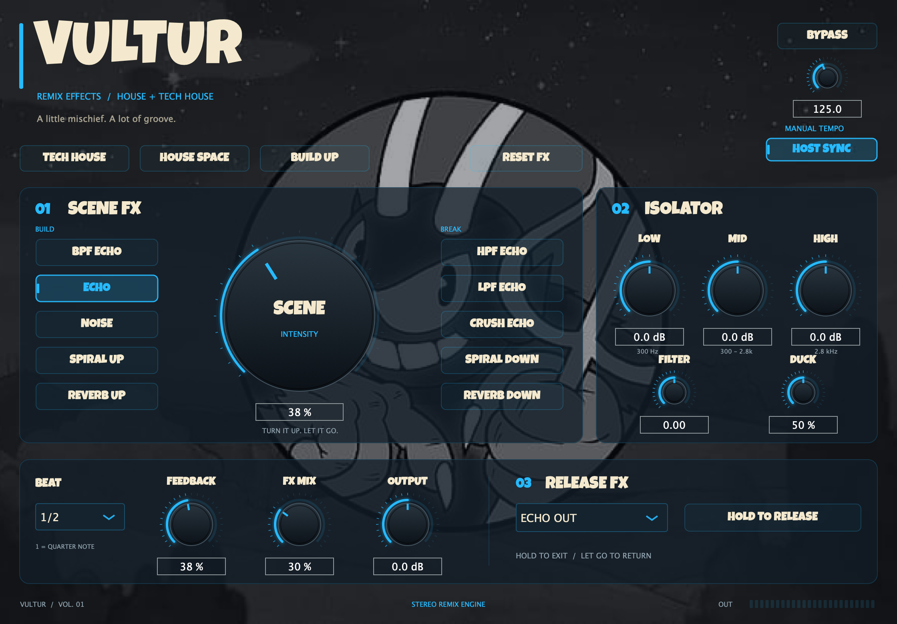

# Vultur

Plugin nativo de efectos para **house y tech house**, inspirado en el flujo de trabajo de la Pioneer RMX-1000. Proyecto independiente de FindNote, con JUCE, controles circulares azul neón, fondo proporcionado por el usuario y la misma fuente Luckiest Guy.



## Controles

- **Scene FX:** BPF Echo, Echo, Noise, Spiral Up, Reverb Up, HPF Echo, LPF Echo, Crush Echo, Spiral Down y Reverb Down. El control central determina la intensidad. Al abrir por primera vez está a cero.
- **Isolator:** LOW, MID y HIGH con divisiones a 300 Hz y 2.8 kHz; de kill (−60 dB) a +6 dB. Cruces [Linkwitz–Riley de cuarto orden, 24 dB/octava](https://docs.juce.com/master/classjuce_1_1dsp_1_1LinkwitzRileyFilter.html), con compensación de fase entre las tres ramas. En neutro conserva la magnitud, pero cambia la fase: no es idéntico muestra a muestra a la entrada. El bypass sí lo es. Kill anula la ganancia de la rama elegida; la atenuación total depende de la frecuencia y del solapamiento de los cruces, no supone silencio absoluto de toda una banda.
- **Filter:** a la izquierda low-pass, centro neutro, a la derecha high-pass. **Duck** reduce el efecto en transitorios de la entrada.
- **Beat:** duración expresada en beats; **1 es una negra**, 1/2 una corchea y 3/4 una corchea con puntillo. HOST SYNC toma el BPM del DAW si está disponible entre 40 y 240; si falta o es inválido usa el BPM manual. Sin detección automática del tempo del audio.
- **Feedback:** realimentación hasta 82%. **FX Mix** regula Scene FX; no anula el aislador ni Release FX. **Output** ajusta la salida, con recorte de seguridad a ±1; no es un limitador true peak.
- **Release FX:** Echo Out, Vinyl Brake y Back Spin. Mantener pulsado HOLD TO RELEASE para salir; soltar para volver al audio normal. Brake y Back Spin se desvanecen en 1.2 segundos. El trigger no se restaura al reabrir un proyecto.
- **Presets:** Tech House (eco corto y duck), House Space (reverb) y Build Up (HPF Echo). Mantienen el tempo, la sincronía, el bypass y el volumen de salida.
- **Reset FX:** devuelve los efectos a sus valores iniciales; conserva BPM, sync, bypass y output. Doble clic sobre un dial restablece ese parámetro; su valor también se puede escribir.
- **Bypass:** transición de 25 ms al audio original; una vez completada, la salida es idéntica a la entrada.

Los parámetros se pueden automatizar y se guardan en el proyecto del host. Los selectores de Scene FX funden la contribución del efecto al cambiar. Los retardos se suavizan al cambiar de BPM y pueden producir una transición de tono. El estado del delay/reverb no se borra en los cambios de efecto, conservando las colas.

## Alcance sonoro

Los nombres y la agrupación se basan en la [descripción oficial de Pioneer](https://www.pioneerdj.com/en/product/dj-effectors/rmx-1000/) y su [presentación de la RMX-1000](https://forums.pioneerdj.com/hc/en-us/articles/204673769-PIONEER-ANNOUNCES-THE-NEW-RMX-1000-REMIX-STATION).

Son algoritmos propios: delay interpolado y filtrado, bit crushing, ruido, transposición de repeticiones con dos cabezales, reverb JUCE y lectura de un historial para los efectos de vinilo. **No se afirma una emulación exacta del hardware**. No incluye sampler/X-Pad, importación de samples, los modos adicionales de Isolate FX del hardware ni quantize de disparos. El sync sigue el BPM, no alinea disparos a la posición del compás.

Noise genera ruido cuando su intensidad y mezcla están activas, incluso sin entrada; la intensidad desplaza su banda de frecuencias hacia los agudos. Reverb Down cierra progresivamente un low-pass sobre la reverberación y reduce el audio directo; Reverb Up mantiene la cola abierta. Crush Echo cuantiza las repeticiones audibles fuera del bucle de realimentación para evitar ciclos sostenidos por la cuantización.

No se añade latencia de búfer, aunque el aislador cambia la fase. Se declara una cola conservadora de **120 segundos**: con 2 beats a 40 BPM hay 3 segundos entre repeticiones; una realimentación ideal del 82 % necesita aproximadamente 105 segundos para caer 60 dB. La prueba del LPF Echo todavía mide −19.93 dBFS entre los segundos 10 y 16 tras una ráfaga corta; declarar 10 segundos truncaría señal audible. Noise activo es un generador continuo, no una cola de entrada. Los buffers y filtros se reservan al preparar el procesador y los controles continuos se suavizan para la automatización.

## Compilación

Desde la raíz de `vultur`, con CMake ≥ 3.22, un compilador C++17 y Xcode en macOS. La primera configuración descarga la revisión fijada de JUCE si no se proporciona una copia local. Genera VST3, AU y Standalone en macOS; VST3 y Standalone en otras plataformas. No instala plugins ni publica paquetes.

```bash
bash scripts/build.sh
```

En este equipo, para reutilizar CMake y la copia de JUCE de FindNote sin modificarlos:

```bash
CMAKE_BIN=/Users/luis/Projects/Personal/findnote/.tools/venv/bin/cmake JUCE_SOURCE=/Users/luis/Projects/Personal/findnote/build/_deps/juce-src bash scripts/build.sh
```

Salidas de macOS:

```text
build/Vultur_artefacts/Release/VST3/Vultur.vst3
build/Vultur_artefacts/Release/AU/Vultur.component
build/Vultur_artefacts/Release/Standalone/Vultur.app
build/VulturPreview_artefacts/Release/Vultur Preview.app
docs/images/vultur.png
```

Para abrir la **interfaz interactiva sin audio**, desde la raíz y después de compilar:

```bash
open "build/VulturPreview_artefacts/Release/Vultur Preview.app" --args --show
```

Para abrir la aplicación con audio y elegir el dispositivo en sus ajustes, desde la raíz y después de compilar:

```bash
open "build/Vultur_artefacts/Release/Standalone/Vultur.app"
```

El preview se captura con el editor JUCE real, a resolución doble. No es un mockup HTML. El generador usa el preset Tech House para mostrar la posición de los controles; al insertar una instancia nueva del plugin, la intensidad empieza en cero.

## Validación

Validación de la revisión del 12 de noviembre de 2026: VST3, AU y Standalone recompilados en macOS arm64. CTest pasó **las dos suites**: 13 624 comprobaciones de audio/estado y 158 de regresión de la revisión. Se regeneró y revisó visualmente el preview con la imagen de fondo a pantalla completa y paneles translúcidos. La compilación firma los bundles ad hoc y comprueba su integridad al finalizar.

Antes de corregir el aislador, la nueva prueba reprodujo **−14.34 dB a 60 Hz** con LOW en kill. Después del cambio, en mono y estéreo a 44.1, 48, 96 y 192 kHz:

| Medición | Resultado |
| --- | --- |
| LOW kill, 60 Hz | −55.94 a −55.93 dB |
| MID kill, 900 Hz | −33.12 a −32.92 dB |
| HIGH kill, 12 kHz | −60.39 a −51.01 dB |
| Neutro a 60, 300, 900, 2800 y 12000 Hz | Error de nivel inferior a 0.05 dB |
| Conservar otra banda al hacer kill | Error de nivel inferior a 0.05 dB |

Las pruebas de Noise y Reverb Down comparan energía espectral normalizada para distinguir un cambio de timbre de un simple cambio de volumen. También se comprueba que la cola del eco supera los 10 segundos. El [informe de revisión](docs/validation/review-2026-11-12.json) registra los hashes de fuentes y binarios, el resultado de CTest y las verificaciones de firma. Los archivos históricos de fallos se conservan; no representan el estado de esta ejecución.

`Tests/ProcessorTests.cpp` comprueba mono y estéreo a 44.1, 48, 96 y 192 kHz, efectos, salida finita y acotada, bypass, estado, triggers, sync/fallback de BPM, tiempo de llegada del eco, independencia de canales, kill, silencio y preparación repetida. `Tests/ReviewTests.cpp` mide los cortes por banda, la respuesta neutra, el barrido de Noise, el timbre de Reverb Down y el eco largo. `Tests/Preview.cpp` genera la captura y permite inspección interactiva sin abrir dispositivos de audio.

La compilación y pruebas locales no sustituyen la escucha con música real ni la validación en Ableton/Logic. La compatibilidad con otros sistemas y arquitecturas requiere compilación y ejecución allí.

## Archivos y recursos

- `Source/Effects.*`: motor de audio.
- `Source/PluginProcessor.*`: parámetros, tempo, presets y estado.
- `Source/PluginEditor.*`: interfaz, controles y fuente integrada.
- `assets/cuphead.jpg`: copia de `/Users/luis/Pictures/cuphead.jpg`.
- `assets/fonts/`: fuente y avisos originales de FindNote; Luckiest Guy no es la fuente oficial de Cuphead.
- `CMakeLists.txt`, `scripts/build.sh`, `Tests/`: compilación y validación.

JUCE está fijado a `dabd5ad13cd869cba41046947fffc8e5ce5cd662`, la misma revisión que FindNote. Se conservan la licencia Apache 2.0 y el aviso de Luckiest Guy. El fondo es el recurso aportado por el usuario; no se ha publicado ni instalado el plugin.
